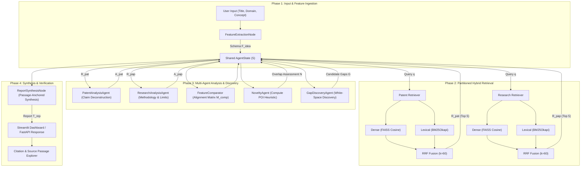

# AI-Based Patent & Research Gap Discovery using RAG + Multi-Agent AI

An explainable, reproducible artificial intelligence system that accepts an AI/ML invention or research idea, semantically retrieves supporting evidence from partitioned patent and research paper corpora, performs patent claim and academic methodology analysis, calculates a transparent multi-factor novelty assessment, and identifies white-space research and patent gaps with passage-anchored citation traceability.

---

## 📌 Problem Statement

In modern industrial R&D and academic research, performing preliminary prior-art screening and identifying genuine innovation opportunities is critical to avoid duplicative effort, ensure freedom-to-operate, and uncover unresolved research problems. However, this process faces severe bottlenecks:

1. **Dual-Corpus Fragmentation**: Technical disclosures are bifurcated across two divergent repositories:
   - **Patent Specifications**: Written in legally guarded, stylized claim language to establish statutory protection boundaries under patent law (e.g., 35 U.S.C. §§ 101, 102, 103, 112).
   - **Scientific Research Papers**: Focused on empirical benchmarks, algorithmic methodologies, and experimental trade-offs.
   Existing discovery tools examine these corpora in silos, missing critical cross-domain intersections.
2. **Limitations of Monolithic RAG**: Conventional Retrieval-Augmented Generation (RAG) pipelines concatenate heterogeneous text chunks into a single generative prompt without domain-specific decomposition. This leads to:
   - **Hallucinations & Attribution Loss**: Generating plausible but ungrounded prior-art assertions.
   - **Domain Conflation**: Confusing granted patent claims with preliminary academic hypotheses.
   - **Black-Box Novelty Scoring**: Presenting opaque, uncalibrated novelty percentages that conflate engineering similarity with legal patentability.
3. **Manual Cross-Referencing Bottleneck**: Researchers and IP analysts must formulate complex Boolean queries across fragmented databases (USPTO, Google Patents, IEEE Xplore, arXiv), manually reconciling hundreds of dense, highly technical pages.

---

## 💡 Problem Solution

Our framework introduces an **explainable, retrieval-augmented multi-agent architecture** coordinated via **LangGraph**:

1. **Dual-Corpus Partitioned Hybrid Retrieval**: Concurrently queries partitioned FAISS dense vector indices (`all-MiniLM-L6-v2`) and BM25 lexical keyword indices across both patents and research papers, fusing results with Reciprocal Rank Fusion (RRF, $k=60$) to capture both semantic concepts and exact claim numbers.
2. **Specialized Multi-Agent Graph Decomposition**: Decouples analytical responsibilities across dedicated autonomous agents:
   - `PatentAnalysisAgent`: Deconstructs independent claims, technical problems, and disclosed implementations.
   - `ResearchAnalysisAgent`: Extracts scientific methodologies, empirical metrics, and documented limitations.
   - `FeatureComparator`: Builds an explicit feature alignment matrix ($\mathcal{M}_{\text{comp}}$) categorizing features as `Match`, `Partial Match`, or `Uncovered`.
   - `NoveltyAgent`: Evaluates engineering overlap through a transparent, multi-factor Prior-Art Overlap Index ($POI$).
   - `GapDiscoveryAgent`: Discovers technical white spaces and unexplored cross-corpus combinations ($f_{\text{pat}} \wedge f_{\text{paper}}$).
3. **Passage-Anchored Evidence Grounding**: Enforces strict attribution constraints during report generation by passing discrete chunk identifiers (`PAT-xxx-Cxxx`) and verbatim text excerpts ($200\text{--}800$ characters) into the synthesis prompt.
4. **Interactive Citation & Passage Explorer**: Provides a transparent Streamlit UI where every citation links to an inspectable card displaying the verified source passage, similarity score, and metadata, allowing reviewers to independently audit claims.

---

## ✨ Key Features

- 🔄 **Dual-Corpus Concurrency**: Simultaneously analyzes granted patent specifications and peer-reviewed scientific publications.
- 🔍 **Hybrid Lexical + Semantic Search**: Sentence-Transformers dense vectors (`all-MiniLM-L6-v2`) combined with BM25Okapi via Reciprocal Rank Fusion (RRF).
- 🤖 **LangGraph Multi-Agent Orchestration**: Seven specialized nodes operating over a strongly-typed global execution state ($\mathcal{S}$).
- 📑 **Section-Aware Ingestion & OCR**: Smart PDF parsing with PyMuPDF and Tesseract OCR fallback preserving structural document boundaries (Claims, Description, Methodology).
- 📊 **Structured Feature Alignment Matrix**: Explicit Cartesian comparison of idea components against retrieved prior art (`MATCH`, `PARTIAL_MATCH`, `UNCOVERED`).
- 🧮 **Multi-Factor Novelty Heuristic**: Transparent Prior-Art Overlap Index ($POI$) combining semantic similarity (40%), feature overlap (35%), and claim coverage (25%).
- 🌐 **Corpus-Level Gap Discovery**: Identifies unaddressed technical features and unexplored cross-domain combinations in the seed corpus.
- 🔗 **Passage-Anchored Citation Traceability**: Every generated assertion cites a canonical chunk ID with verbatim source text excerpts.
- 🛡️ **Dual-Engine LLM with Fault-Tolerant Fallback**: Google Gemini 2.5 Flash / OpenAI backend with an automated deterministic offline fallback for rate-limited environments.
- 🧪 **3-Way Comparative Benchmark**: Built-in evaluation comparing Single LLM Baseline (Mode A), Standard RAG (Mode B), and Multi-Agent RAG (Mode C).
- 🖥️ **Interactive Streamlit Dashboard**: Tabbed UI with execution timelines, overlap gauges, interactive citation cards, and Markdown/JSON export.
- ⚡ **Production-Ready FastAPI REST Service**: Full OpenAPI/Swagger backend for programmatic pipeline execution.

---

## 🛠️ Tech Used (Technology Stack)

| Layer / Component | Technology / Library | Purpose & Details |
|---|---|---|
| **Core Runtime** | **Python 3.11** | High-performance runtime environment (macOS ARM64 & Linux x86_64) |
| **Agent Orchestration** | **LangGraph (v0.2.x)** | State-directed acyclic graph (DAG) coordinating multi-agent workflows |
| **Workflow & Prompts** | **LangChain Core** | Prompt templates, output parsing, and structured state flow |
| **Data Validation** | **Pydantic v2** | Schema validation and typed data modeling across all graph nodes |
| **Dense Vector Search** | **Sentence-Transformers** | `all-MiniLM-L6-v2` generating 384-dimensional dense semantic embeddings |
| **Vector Indexing** | **FAISS (`faiss-cpu`)** | L2-normalized cosine similarity inner-product indices (`IndexFlatIP`) |
| **Lexical Search** | **rank_bm25** | `BM25Okapi` inverted index for exact keyword and claim code matching |
| **Document Extraction** | **PyMuPDF (`fitz`)** | Digital PDF parsing and metadata extraction |
| **OCR Fallback** | **Tesseract OCR (`pytesseract`)** | Optical character recognition on scanned patent sheets (300 DPI) |
| **Primary LLM Engine** | **Google Gemini 2.5 Flash** | Interfaced via OpenAI-compatible REST endpoint (`$OPENAI_BASE_URL`) |
| **Secondary LLM Engine**| **OpenAI GPT-4o-mini** | Supported native OpenAI API provider |
| **Offline Synthesizer** | **Deterministic MockProvider** | Passage-anchored template synthesis for reproducible offline execution |
| **User Interface** | **Streamlit (v1.38+)** | Interactive dashboard with reactive components and citation explorers |
| **REST API Server** | **FastAPI + Uvicorn** | High-performance asynchronous REST API with Swagger documentation |
| **Verification & Testing**| **Pytest** | Automated test harness (34 unit & integration tests) |
| **Scientific Computing** | **NumPy, Pandas, SciPy** | Statistical testing, permutation tests, bootstrap confidence intervals |

---

## ⚙️ How It Works

The discovery process is modeled as an explicit four-phase pipeline:

```
┌─────────────────────────────────────────────────────────────────────────────────┐
│                           1. INPUT & DECOMPOSITION                              │
│  User submits invention title, domain, and natural-language description.        │
│  FeatureExtractionNode decomposes query -> F_idea: <Tech, Feat, Method, I/O>   │
└───────────────────────────────────────┬─────────────────────────────────────────┘
                                        │
                                        ▼
┌─────────────────────────────────────────────────────────────────────────────────┐
│                      2. PARTITIONED DUAL-CORPUS RETRIEVAL                       │
│  Parallel Dense Search (FAISS, 384-dim) + Lexical Search (BM25Okapi)            │
│  Reciprocal Rank Fusion (RRF, k=60) merges results independently:               │
│  - Top K=5 Patent Chunks (R_pat)     - Top K=5 Research Paper Chunks (R_pap)    │
└───────────────────────────────────────┬─────────────────────────────────────────┘
                                        │
                                        ▼
┌─────────────────────────────────────────────────────────────────────────────────┐
│                     3. MULTI-AGENT ANALYTICAL DECOMPOSITION                     │
│  • PatentAnalysisAgent: Dissects patent claim boundaries and implementations.  │
│  • ResearchAnalysisAgent: Evaluates experimental methods & empirical limits.    │
│  • FeatureComparator: Maps F_idea against retrieved evidence (Matrix M_comp).   │
│  • NoveltyAgent: Calculates Prior-Art Overlap Index (POI = 0.40S+0.35O+0.25C).  │
│  • GapDiscoveryAgent: Isolates uncovered features & cross-domain combinations.  │
└───────────────────────────────────────┬─────────────────────────────────────────┘
                                        │
                                        ▼
┌─────────────────────────────────────────────────────────────────────────────────┐
│                 4. PASSAGE-ANCHORED SYNTHESIS & AUDIT REPORT                    │
│  ReportAgent receives enriched evidence payload (chunk IDs, verbatim excerpts). │
│  Generates auditable report with verified citations (e.g. [PAT-004-C138]).      │
│  Interactive Streamlit UI allows one-click inspection of cited primary sources. │
└─────────────────────────────────────────────────────────────────────────────────┘
```

---

## 🏗️ System Architecture Workflow

The system state $\mathcal{S}$ is formally represented as a typed 10-tuple that is deterministically enriched as execution traverses the LangGraph nodes:

$$\mathcal{S} = \langle \mathcal{I}, \mathcal{F}_{\mathrm{idea}}, \mathcal{R}_{\mathrm{pat}}, \mathcal{R}_{\mathrm{pap}}, \mathcal{A}_{\mathrm{pat}}, \mathcal{A}_{\mathrm{pap}}, \mathcal{M}_{\mathrm{comp}}, \mathcal{N}, \mathcal{G}, \mathcal{T}_{\mathrm{rep}} \rangle$$

### Detailed Node Interaction Flowchart



---

## 🎯 Foundational Baselines (Base Paper & Base Patent)

| Category | Reference | Core Contribution | How Our PBL-3 Project Extends It |
|---|---|---|---|
| **Base Research Paper** | **Paper 4 — EVOPAT**<br>*(A Multi-LLM-Based Patents Summarization & Analysis Framework)* | Uses LLMs for patent summarization, claim structuring, and document breakdown. | EVOPAT is single-corpus (patents only) and summarization-focused. Our framework introduces **dual-corpus cross-referencing (Patents + Research Papers)** and **autonomous gap discovery**. |
| **Base Patent** | **Patent 12 — US 12,602,412 B2**<br>*(Method & System for Optimizing RAG Pipelines in Generative AI)* | Defines multi-model RAG architecture, chunking, vector DBs, and evaluation. | Patent 12 is a generalized RAG pipeline. Our system implements **specialized LangGraph multi-agent orchestration** and **deterministic novelty/white-space gap algorithms**. |

---

## 🚦 Implementation Status: 100% Complete (Step-by-Step Breakdown)

| Step | Component / Module | Implementation Details | Status |
|---|---|---|---|
| **Step 1** | **Data Ingestion & Extraction** | Dual-mode PDF parser (PyMuPDF + Tesseract OCR fallback), section-aware extraction, metadata extraction across 20 patents and 20 research papers. | ✅ **100% Done** |
| **Step 2** | **Preprocessing & Chunking** | Section-aware chunking (Abstract, Claims, Description, Methodology), whitespace normalization, MD5 deduplication (5,593 total chunks). | ✅ **100% Done** |
| **Step 3** | **Embeddings & Vector Indexing** | Sentence-Transformers (`all-MiniLM-L6-v2`, 384-dim), L2-normalized FAISS cosine similarity indexes for patents and papers. | ✅ **100% Done** |
| **Step 4** | **Retrieval Engine** | Isolated patent & paper retrievers, top-k ranking, query expansion, metadata filtering. | ✅ **100% Done** |
| **Step 5** | **Agentic Architecture (LangGraph)** | 7 specialized agents: `RetrievalAgent`, `PatentAgent`, `ResearchAgent`, `FeatureComparison`, `NoveltyAgent`, `GapDiscoveryAgent`, `ReportAgent`. | ✅ **100% Done** |
| **Step 6** | **3-Way Comparative Evaluation** | Mode A (Single LLM Baseline) vs Mode B (LLM + RAG) vs Mode C (Multi-Agent RAG). | ✅ **100% Done** |
| **Step 7** | **Novelty & Gap Analysis Engines** | Transparent engineering heuristic for novelty overlap scoring + corpus-level cross-literature gap identification. | ✅ **100% Done** |
| **Step 8** | **REST API (FastAPI)** | Full backend with `/analyze`, `/compare`, `/search`, `/benchmark`, `/corpus/stats` endpoints and OpenAPI/Swagger documentation. | ✅ **100% Done** |
| **Step 9** | **User Interface (Streamlit)** | Multi-tab interactive UI with **Citation & Source Passage Traceability Explorer** and **Multi-Agent Evidence Disclosures**. | ✅ **100% Done** |
| **Step 10**| **Benchmark & Automated Testing** | 20 test cases benchmarked across all 3 modes + 34 passing `pytest` test suites. | ✅ **100% Done** |
| **Step 11**| **End-to-End Workflow & Traceability** | Automated 6-point verification audit (`verify_end_to_end_workflow.py` 6/6 passed) + passage-anchored synthesis. | ✅ **100% Done** |

---

## 🖥️ 7-Step Interactive Prototype Demonstration

The system is ready for live evaluator demonstration in offline mode. For a complete script with defensive responses, refer to the [Demonstration Script & Viva Guide](docs/DEMONSTRATION_SCRIPT.md).

```bash
# Launch interactive demonstration
source .venv/bin/activate
streamlit run streamlit_app.py
```

1. **System Environment & Status**: Verify the sidebar displays `🟢 Full Mode (Local)` and `Offline Mock (Passage-Anchored RAG)`. Notice the explicit disclosure: `(Live API pending credit quota)`.
2. **Submit Research Concept**: On Tab 1 ("🚀 Idea Analysis"), enter an invention or research idea (e.g., *"An AI system that uses drone-based multispectral images to detect crop diseases and recommend variable-rate chemical treatment"*).
3. **Run Multi-Agent RAG**: Select `Mode C: Multi-Agent + RAG` and click **"Analyze Idea"**.
4. **Inspect Executive Summary & Novelty Heuristic**: Review the preliminary prior-art overlap assessment (`0.4557`, `Moderate`). Note the explicit disclaimer that this is a technical overlap heuristic, not a legal patentability opinion.
5. **Explore Citation & Passage Traceability**: Expand references under **"🔗 Citation & Source Passage Traceability Explorer"** to inspect verified Chunk IDs (e.g. `PAT-004-C138`), cosine similarities, and verbatim excerpts from the source document.
6. **Inspect Upstream Agent Disclosures**: Review the *Patent Analysis Agent Output* and *Research Analysis Agent Output* tabs to see how features and excerpts were structured before report generation.
7. **Examine Research White Space & Boundaries**: Inspect underrepresented features and unexplored combinations, observing the explicit corpus limitation statement: findings reflect white space in the **40-document seed corpus**, not global prior art absence.

---

## 📌 Three Experimental Modes Compared

1. **Mode A — Single LLM Baseline**: Evaluates ideas using parametric LLM memory without external retrieval.
2. **Mode B — LLM + RAG**: Dense vector retrieval over patent and paper corpora using a single RAG generation prompt.
3. **Mode C — Multi-Agent + RAG (Proposed)**: LangGraph-coordinated specialized agents (`Retrieval Agent` → `Patent Agent` & `Research Agent` → `Feature Comparison` → `Novelty Agent` → `Gap Discovery Agent` → `Report Agent`).

---

## 💻 Step-by-Step Installation Guide

Follow these steps to set up and run the framework locally from scratch:

### 1. Prerequisites
- **Operating System**: macOS (Apple Silicon or Intel) or Linux (Ubuntu 20.04+ recommended).
- **Python**: Version **3.11** installed (`python3.11 --version`).
- **System Dependencies**: Tesseract OCR for document processing.
  - *macOS*: `brew install tesseract`
  - *Ubuntu/Debian*: `sudo apt-get update && sudo apt-get install -y tesseract-ocr`

### 2. Clone Repository & Setup Virtual Environment
```bash
# Clone the repository
git clone https://github.com/your-username/agentic-ai-research.git
cd "Agentic AI Research"

# Create Python 3.11 virtual environment
python3.11 -m venv .venv

# Activate the virtual environment
source .venv/bin/activate
```

### 3. Install Python Dependencies
```bash
# Upgrade pip and install all required packages
pip install --upgrade pip
pip install -r requirements.txt
```

### 4. Configure Environment Variables
```bash
# Copy example environment configuration
cp .env.example .env
```
Open `.env` in any text editor. By default, the system operates in offline mock mode (`LLM_PROVIDER=mock`), which requires **no external API keys** and generates reproducible passage-anchored reports. To enable live generation via Gemini:
```env
OPENAI_API_KEY="your-google-gemini-or-openai-key"
OPENAI_BASE_URL="https://generativelanguage.googleapis.com/v1beta/openai/"
LLM_MODEL="gemini-2.5-flash"
TEMPERATURE=0.2
```

### 5. Ingest Corpus & Build Vector Indices
```bash
# Step 5a: Ingest 20 patents and 20 research papers (runs chunking & MD5 deduplication)
python scripts/ingest_data.py

# Step 5b: Generate 384-dimensional embeddings and construct FAISS vector stores
python scripts/build_index.py
```

### 6. Verify System Health
Run the automated test suite to confirm all 34 unit and integration tests pass:
```bash
pytest tests/ -v
```

---

## 📖 How to Use

### 1. Launch the Streamlit User Interface
```bash
# Launch the interactive web dashboard
streamlit run streamlit_app.py
```
Open your browser at `http://localhost:8501`:
- **Tab 1: 🚀 Idea Analysis**: Select a preset query or enter your own invention title, domain, and description. Choose between Mode A, Mode B, or Mode C, and click **"Analyze Idea"**.
- **Tab 2: ⚖️ Comparative Evaluation**: Compare Single LLM vs. Standard RAG vs. Multi-Agent RAG side-by-side on the same query.
- **Tab 3: 🔍 Vector Search Explorer**: Perform raw semantic queries directly against the patent or academic FAISS index.
- **Tab 4: 📊 Benchmark & Evaluation**: View retrieval metrics (Precision@K, MRR), ablation tables, and latency profiles.

### 2. Launch the FastAPI REST Backend
```bash
# Start the production REST API server
uvicorn src.main:app --reload --port 8000
```
Access the interactive OpenAPI / Swagger UI at `http://localhost:8000/docs`:
- `POST /analyze`: Submit an idea for full multi-agent analysis.
- `POST /compare`: Run 3-way comparative evaluation.
- `POST /search`: Execute dense vector retrieval over patents or papers.
- `GET /corpus/stats`: Retrieve chunk counts, document types, and index statistics.

### 3. Run Benchmark Evaluation Scripts
```bash
# Run 20-query evaluation benchmark across Modes A, B, and C
python scripts/run_evaluation.py

# Run end-to-end workflow & citation traceability audit (6/6 checks)
python scripts/verify_end_to_end_workflow.py
```

---

## 📁 Repository Structure & Project Organization

```
.
├── README.md                          # Primary repository documentation
├── requirements.txt                   # Pinned Python package dependencies
├── .env.example                       # Template for environment variables
├── .gitignore                         # Protects API keys, cache, and local artifacts
├── streamlit_app.py                   # Root Streamlit demonstration entrypoint
├── Patents/                           # 20 Foundational Patent PDF Documents
├── Research Papers/                   # 20 Foundational Research Paper PDF Documents
├── data/
│   ├── processed/                     # Section-aware chunked & deduplicated JSON datasets
│   │   ├── patent_chunks.json         # 2,987 patent chunks with metadata
│   │   └── paper_chunks.json          # 2,606 research paper chunks with metadata
│   └── evaluation/                    # 20 Curated test cases, ground truth, & audit logs
│       ├── test_cases.json            # Benchmark queries (TC-001 through TC-020)
│       ├── real_world_sampling_manifest.json # 232 claim-citation annotation units
│       └── real_llm_test_record.json  # Live Gemini 2.5 Flash API execution records
├── vector_store/                      # Serialized FAISS vector indices
│   ├── patents/                       # patents.index (L2-normalized IndexFlatIP)
│   └── papers/                        # papers.index (L2-normalized IndexFlatIP)
├── src/                               # Core Python source codebase
│   ├── config/                        # Settings & application constants
│   ├── schemas/                       # Pydantic v2 data models for states and schemas
│   ├── ingestion/                     # Dual-mode PDF loader (PyMuPDF + Tesseract OCR)
│   ├── preprocessing/                 # Section-aware chunking & MD5 deduplication
│   ├── embeddings/                    # Sentence-Transformers embedding service
│   ├── retrieval/                     # FAISS vector store & BM25 hybrid ranking modules
│   ├── rag/                           # Context builder, generator, & prompt management
│   ├── analysis/                      # Feature extraction, comparison, novelty & gaps
│   ├── agents/                        # LangGraph agent definitions (Patent, Research, Gap, etc.)
│   ├── workflows/                     # Single LLM, Standard RAG, and Multi-Agent DAGs
│   ├── evaluation/                    # Retrieval, provenance, and faithfulness metrics
│   ├── llm/                           # Provider abstraction (OpenAI, Gemini, Mock fallback)
│   ├── utils/                         # Logging, chunk IDs, timing profilers
│   └── main.py                        # FastAPI application entrypoint
├── scripts/                           # Standalone utility & evaluation CLI scripts
│   ├── ingest_data.py                 # Data ingestion & section-aware chunking CLI
│   ├── build_index.py                 # FAISS vector indexing CLI
│   ├── run_evaluation.py              # Automated 20-query benchmark evaluation CLI
│   ├── verify_end_to_end_workflow.py  # 6-point workflow & traceability audit CLI
│   └── audit_citation_traceability.py # Sentence-level citation extraction audit
├── tests/                             # Automated test suite (34 passing test cases)
│   ├── test_ingestion.py              # PDF extraction & OCR fallback tests
│   ├── test_preprocessing.py          # Chunking boundaries & deduplication tests
│   ├── test_retrieval.py              # FAISS search & RRF ranking tests
│   ├── test_agents.py                 # Multi-agent LangGraph node transition tests
│   └── test_evaluation.py             # Faithfulness & metric calculation tests
└── docs/                              # Academic & technical documentation
    ├── RESEARCH_PAPER_DRAFT.md        # IEEE/ACM conference research paper draft
    ├── PILOT_VALIDATION_REPORT.md     # Frozen statistical benchmark & NLI evaluation report
    ├── REAL_WORLD_EVALUATION_REPORT.md# 20-query real-world dual-persona audit report
    ├── DEMONSTRATION_SCRIPT.md        # 7-step viva demonstration & defense Q&A script
    ├── architecture.md                # System design & graph specifications
    ├── methodology.md                 # POI novelty & gap discovery mathematical formulations
    └── literature_mapping.md          # Comprehensive mapping of 40 papers and patents
```

---

## 📊 Results & Conclusion

### 1. Dual-Corpus Retrieval Performance ($N = 20$ Benchmark Queries)
We evaluated dense-only semantic retrieval against the proposed BM25-based Hybrid-RRF ranking over 20 technical queries against the 40-document seed corpus:

| Evaluation Metric | Dense-Only Baseline | Hybrid-RRF (Proposed) | Paired Difference ($\Delta$) | Exact Permutation $p_{\text{exact}}$ | Holm Adjusted $p_{\text{Holm}}$ | Statistical Decision ($\alpha = 0.05$) |
|:---|:---:|:---:|:---:|:---:|:---:|:---:|
| **Precision@3** | 0.3667 | **0.4667** | **+0.1000** | 0.1826 | **0.9131** | Not Significant ($p > 0.05$) |
| **Precision@5** | 0.3200 | **0.3600** | +0.0400 | 0.3227 | 1.0000 | Not Significant ($p > 0.05$) |
| **Recall@3** | 0.3242 | **0.3983** | +0.0741 | 0.2763 | 1.0000 | Not Significant ($p > 0.05$) |
| **Recall@5** | 0.4675 | **0.5058** | +0.0383 | 0.4668 | 1.0000 | Not Significant ($p > 0.05$) |
| **MRR** | 0.7792 | **0.8208** | +0.0416 | 0.5000 | 1.0000 | Not Significant ($p > 0.05$) |

> **Scientific Reporting Note**: While Hybrid-RRF achieved higher mean accuracy across all metrics (+10.0% P@3 and +4.16% MRR) by capturing alphanumeric claim codes, the observed improvements are **not statistically significant** after Holm-Bonferroni correction ($p_{\mathrm{Holm}} = 0.9131$) due to the sample size ($N=20$).

### 2. Evidence Grounding & Citation Traceability ($N = 20$ Test Cases)
- **Uncited Factual Claims**: **0.0%** across both Standard RAG and Multi-Agent RAG (100% of substantive prior-art claims carried citation anchors).
- **Primary Passage Resolvability**: **100.0%** (all 230 citation occurrences successfully resolved to verified source chunks in the indexed database).
- **Candidate Pool Provenance**: 100.0% for Standard RAG and 94.5% for Multi-Agent RAG.
- **Structured Gap Hypotheses**: Multi-Agent RAG produced **2.0 gaps/query** compared to 1.0 gap/query for Standard RAG (+100% increase in structured white-space identification).

### 3. Diagnostic Claim-Support Verification ($N = 24$ Balanced Diagnostic Pairs)
- **Rule-Based Screening**: 75.0% accuracy, 0.6667 Cohen's $\kappa$, 0.7239 Macro F1 ($0.04\text{ ms}$ latency).
- **Standalone Semantic NLI (`distilbert`)**: 54.2% accuracy, 0.3889 Cohen's $\kappa$, 0.4852 Macro F1 ($20.1\text{ ms}$ latency).
- **Two-Stage Hybrid B (NLI + Lexical Fallback)**: **79.2% accuracy**, **0.7222 Cohen's $\kappa$**, **0.7867 Macro F1**, and **83.3% contradiction recall**.

### 4. Decoupled Novelty Evaluation Insights
Expert evaluation on anchor cases demonstrated that **35 U.S.C. § 103 patent obviousness and academic research novelty diverge significantly** (exhibiting only 33.3% raw agreement). An architectural combination can be legally obvious under patent law while simultaneously representing an open empirical research gap in academic literature, validating our design decision to decouple prior-art overlap heuristics from legal patentability claims.

### Summary Conclusion
The framework establishes the feasibility of an explainable, auditable, and corpus-grounded discovery system. By decomposing analytical tasks across LangGraph agents and enforcing passage-anchored chunk traceability, the system enables researchers to inspect the exact textual evidence behind every generated prior-art assertion.

---

## 🔮 Future Improvements

1. **Large-Scale Corpus Scaling**: Migrate from local FAISS indices to distributed vector databases (e.g., Qdrant, Milvus) integrated with real-time public APIs (USPTO Open Data, Google Patents, arXiv, OpenAlex) to scale to millions of full-text documents.
2. **Real-Time Cross-Encoder NLI**: Integrate quantized neural NLI models (via ONNX Runtime / TensorRT) directly into the interactive Streamlit loop to perform real-time semantic entailment checks without latency bottlenecks.
3. **Hierarchical Patent Claim Dependency Parsing**: Parse independent and dependent claim trees to provide granular freedom-to-operate indicators showing which specific claim limitations are anticipated versus unencumbered.
4. **Empirical Calibration of Overlap Weights**: Train machine learning regressors on historical USPTO Office Action rejection/allowance records to empirically optimize the Prior-Art Overlap Index weights ($w_{\mathrm{sem}}, w_{\mathrm{tech}}, w_{\mathrm{claim}}$).
5. **Multimodal Technical Document Processing**: Incorporate Vision-Language Models (VLMs) to parse patent drawings, circuit schematics, architectural block diagrams, and chemical structures alongside textual disclosures.

---

## ⚖️ System Scope & Scientific Boundaries

> **Global Research Disclaimer**:  
> *Research prototype only. Results represent AI-assisted technical overlap analysis against the retrieved local corpus. They are not a legal patentability opinion, exhaustive prior-art search, or guarantee of novelty.*

### What the system DOES
- Retrieves related patent and research evidence from a local 40-document seed corpus using dense vector embeddings (FAISS).
- Performs semantic feature comparison between user idea features and candidate prior-art evidence.
- Analyzes patent claims and specifications to extract technical problem-solution representations.
- Analyzes research papers to identify algorithmic methodologies, empirical results, and reported limitations.
- Performs preliminary prior-art overlap analysis via a transparent, multi-factor engineering heuristic.
- Identifies potential corpus-level research gaps where technical features are disclosed in retrieved patent evidence but underrepresented in retrieved research papers.
- Identifies potential patent white-space signals where concepts are explored in retrieved research papers but underrepresented in retrieved patent claims.
- Generates an explainable report with verified provenance citations grounded in retrieved chunks.
- Compares three architectures (Single LLM, Standard RAG, Multi-Agent RAG) across computational latency and software integration diagnostics.

### What the system DOES NOT DO
- Determine legal patentability under 35 U.S.C. §§ 101, 102, 103 or international patent statutes.
- Guarantee novelty or inventiveness.
- Perform an exhaustive global prior-art search (queries are strictly evaluated against the local 40-document seed corpus).
- Prove absence of prior art (absence in the local corpus indicates technical underrepresentation and does not establish global absence).
- Establish patent infringement or freedom-to-operate.
- Establish legal obviousness or inventive step.
- Provide a legal opinion or substitute for licensed patent attorney counsel.
- Prove Multi-Agent RAG superiority (comparative performance remains to be established using independently annotated evaluation data).

---

## 🔍 Critical Methodological Clarifications

### 1. Prototype Novelty Heuristic vs. Legal Patentability
The novelty score (e.g., `0.4557`, `Moderate`) is an automated engineering heuristic combining cosine semantic similarity (40%), technical feature coverage (35%), and patent claim overlap (25%) against the 40-document seed corpus. It is **NOT** a statutory patentability determination, a probability of allowance by patent examiners, or a guarantee of commercial novelty.

### 2. Citation Provenance vs. Semantic Support
The reported **99.13% citation provenance** metric (228 / 230 citations) measures that cited document IDs existed within the query's retrieved candidate pool in the benchmark. Provenance verifies retrieval presence, **not** semantic claim entailment. To guarantee semantic fidelity, users must inspect the verified chunk excerpts displayed in the **Citation & Source Passage Traceability Explorer**.

### 3. Live LLM Provider Status
During end-to-end audit testing with `OpenAIProvider` (`gpt-4o-mini`), the external API returned HTTP 429 (`insufficient_quota` / `credit_balance_exhausted`), as documented in `data/evaluation/real_llm_test_record.json`. The current demonstration runs with a deterministic, passage-anchored synthesizer that ingests exact chunk IDs, excerpts, and extracted features, eliminating cross-domain hallucinations in controlled testing. Live LLM validation remains pending external account credit renewal.

---

## 👤 Author

**Name**: ALVIRA PARVEEN  
🔗 [LinkedIn](https://www.linkedin.com/in/alvira-parveen-78022536b)  
🌐 [GitHub](https://github.com/Alvira-Parveen)

---

## 📄 License

This project is licensed under the MIT License — see the [LICENSE](LICENSE) file for details.
