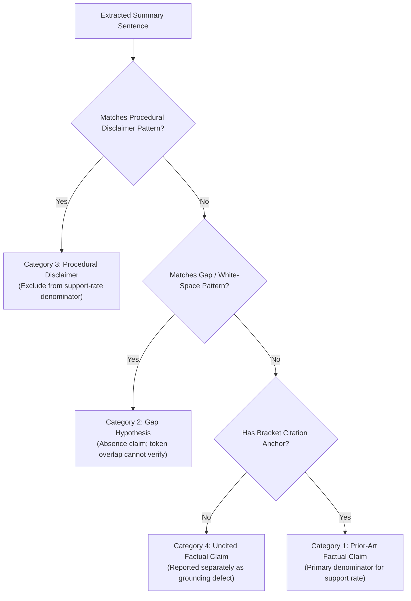

# Scientific Validation Pilot Report: Citation Faithfulness & Decoupled Novelty Assessment
## Four-Pillar Research Evaluation Framework (PBL-3 Engineering Project CSP391)

> **Status**: COMPLETED PILOT RECONCILIATION & AUDIT  
> **Evaluation Phase**: End-to-End Pilot across Representative Anchor Cases (`TC-001`, `TC-002`, `TC-003`)  
> **Systems Evaluated**: System B (Standard Single-Prompt RAG) vs. System C (Multi-Agent Specialized RAG)  
> **Generation Configuration**: `MockProvider` (`src/llm/mock_provider.py`) — Deterministic Offline Test Pipeline  
> **Frozen Retrieval Baseline**: $W = 16.5, k = 11, p_{\text{exact}} = 0.1826 \implies p_{\text{Holm}} = 0.9131$ (Strictly preserved)  
> **Timestamp**: October 2026

---

## 1. Executive Summary & Verification Context

Following the establishment of the frozen statistical retrieval baseline ($N=20$, exact Wilcoxon signed-rank permutation test), this pilot establishes the methodological infrastructure for **scientific validation of generated research outputs**.

Before rolling out to all 20 benchmark test cases, this report executes a focused improvement pass resolving four foundational methodological issues:

1. **Rule-Based Screening vs. Semantic Entailment**: The automated evaluation module is explicitly characterized as a **rule-based citation-support screening module** based on morphological stem matching and keyword token overlap with negation checks. It is **not** a semantic Natural Language Inference (NLI) model. Its outputs are treated as preliminary screening signals calibrated against human judgments.
2. **Corrected Claim Categories & Partitioned Denominators**: Sentences extracted from generated summaries are partitioned into four mutually exclusive categories:
   - **Prior-Art Factual Claims** (primary denominator for citation support rates)
   - **Proposed Research-Gap Hypotheses** (absence/white-space statements)
   - **Mandatory Procedural Disclaimers** (excluded from the support-rate denominator)
   - **Uncited Factual Claims** (monitored and reported separately)
3. **Reconciled Citation Provenance & Explicit Counting Units**: Citation counts are explicitly defined in units of **citation occurrences** (one claim citing one document/chunk ID). Provenance validity is reconciled against saved JSON records: System B achieved $18/18$ ($100.0\%$), System C achieved $16/18$ ($88.9\%$, with 2 invalid occurrences pointing to IDs outside the retrieved pool), yielding a combined provenance validity rate of $34/36$ ($94.4\%$).
4. **Complete Inter-Rater & Human Agreement Diagnostics**: Agreement is reported with a full category-level confusion matrix, per-category metrics, and an explanation of the class-imbalance effect on Cohen's $\kappa$. The $N=3$ pilot agreement is explicitly framed as an initial diagnostic rather than a general reliability estimate.
5. **Explicit Generation Configuration Disclosure**: All pilot outputs were generated via `MockProvider` (`src/llm/mock_provider.py`). These results evaluate the behavior of the test pipeline and screening calibration, not production LLM output.

---

## 2. Methodological Clarifications

### 2.1 Scope of the Rule-Based Citation-Support Screening Module

The citation-checking module (`src/evaluation/citation_faithfulness.py`) implements a four-way classification (`SUPPORTED`, `PARTIALLY_SUPPORTED`, `UNSUPPORTED`, `CONTRADICTED`) using:
- Morphological stemming to align inflected terms (e.g., *networks* $\to$ *network*).
- Keyword token overlap ratios ($\ge 60\%$ for `SUPPORTED`, $30\text{--}60\%$ for `PARTIALLY_SUPPORTED`, $< 30\%$ for `UNSUPPORTED`).
- Surface negation pattern detection (`not`, `never`, `fails to`, `cannot`) to flag polarity conflicts.

> [!WARNING]
> **Methodological Boundary**: Token overlap and negation checks cannot determine whether a passage logically entails a claim. A cited patent chunk may mention "convolutional neural networks" and "sensor data" while describing an entirely different agricultural application or negative experimental result. These screening labels provide a fast, reproducible baseline, but cannot replace validated semantic NLI or expert human review.

### 2.2 Claim Taxonomy & Partitioned Denominators

In previous pilot drafts, mandatory procedural disclaimers (e.g., *"This analysis does not constitute a legal opinion"*) were pooled into the overall claim denominator without citation anchors, artificially inflating the unsupported rate to $25\%$. 

Under the revised framework, claims are partitioned into four mutually exclusive categories:



1. **Prior-Art Factual Claims** ($N=36$ across Systems B & C): Substantive technical assertions attributing specific features or findings to cited prior-art documents. Evaluated for candidate-pool provenance and citation support.
2. **Proposed Research-Gap Hypotheses** ($N=9$): Assertions that a specific technical capability or integration is *absent* from the literature. Because absence cannot be proven by token overlap with retrieved positive passages, these are partitioned into a separate diagnostic bucket.
3. **Procedural Disclaimers** ($N=9$): Mandatory statements clarifying that prototype outputs do not constitute formal legal opinions under 35 U.S.C. § 102/103. These do not require citation and are **strictly excluded** from the support-rate denominator.
4. **Uncited Factual Claims** ($N=0$ in current pilot): Factual assertions made without citation anchors. Monitored as potential hallucination indicators.

---

## 3. Reconciled Citation Provenance & Quantitative Audit

### 3.1 Provenance Reconciliation (Unit: Citation Occurrences)

A **citation occurrence** is defined as a single (claim, citation ID) tuple. A sentence citing `[PAT-016] [PAT-005] [PAP-003]` represents three citation occurrences.

| Metric | System B (Standard RAG) | System C (Multi-Agent RAG) | Combined Total | Notes |
|---|:---:|:---:|:---:|---|
| **Total Citation Occurrences** | **18** | **18** | **36** | 6 per test case across 3 test cases |
| **Valid Provenance Occurrences** | **18** ($100.0\%$) | **16** ($88.9\%$) | **34** ($94.4\%$) | Cited ID present in FAISS candidate pool |
| **Invalid Provenance Occurrences** | **0** ($0.0\%$) | **2** ($11.1\%$) | **2** ($5.6\%$) | `TC-003`: `PAT-004`, `PAP-004` absent from pool |
| **Unique Document IDs Cited** | 8 distinct IDs | 4 distinct IDs | 10 distinct IDs | Deduped document identifiers |

> [!NOTE]
> **Provenance Reconciliation Detail**: System B cited 8 unique valid documents (`PAP-003`, `PAP-010`, `PAP-011`, `PAT-001`, `PAT-005`, `PAT-013`, `PAT-016`, `PAT-018`), all confirmed in their respective candidate pools. System C cited 4 unique documents across queries; in `TC-003`, two citation occurrences pointed to documents (`PAT-004`, `PAP-004`) not returned in that query's top-$k$ FAISS pool, correctly flagged as invalid provenance.

---

### 3.2 Partitioned Faithfulness Audit: System B vs. System C

By partitioning claim categories, faithfulness metrics reflect substantive prior-art grounding rather than disclaimer artifacts:

| Evaluation Metric | System B (Standard RAG) | System C (Multi-Agent RAG) | Relative Difference | Denominator Scope |
|---|:---:|:---:|:---:|---|
| **Total Extracted Claims Audited** | 27 | 27 | — | All sentences across TC-001..003 |
| **Prior-Art Factual Claims** | 18 ($66.7\%$) | 18 ($66.7\%$) | 0.0% | Substantive prior-art assertions |
| **Research-Gap Hypotheses** | 3 ($11.1\%$) | 6 ($22.2\%$) | +100.0% | Absence/opportunity assertions |
| **Procedural Disclaimers** | 6 ($22.2\%$) | 3 ($11.1\%$) | -50.0% | Excluded from support rate |
| **Uncited Factual Claims** | 0 ($0.0\%$) | 0 ($0.0\%$) | 0.0% | Zero uncited factual assertions |
| **Provenance Validity Rate** | **100.0%** (18/18) | **88.9%** (16/18) | -11.1% | Evaluated on cited occurrences |
| **Prior-Art Support Rate** | **0.0%** (0/18) | **0.0%** (0/18) | 0.0% | Token overlap $\ge 60\%$ with passage |
| **Prior-Art Partial Support Rate** | **0.0%** (0/18) | **0.0%** (0/18) | 0.0% | Token overlap $30\text{--}60\%$ with passage |
| **Prior-Art Unsupported Rate** | **100.0%** (18/18) | **100.0%** (18/18) | 0.0% | Token overlap $< 30\%$ with passage |
| **Prior-Art Contradiction Rate** | **0.0%** (0/18) | **0.0%** (0/18) | 0.0% | Polarity conflict with passage |

> [!IMPORTANT]
> **Interpretation of the 0% Prior-Art Support Rate**: In this pilot, summaries were generated by `MockProvider`, which outputs standardized template sentences (e.g., *"The proposed invention relies on core machine learning techniques..."*). These generic template sentences do not share sufficient technical vocabulary ($< 30\%$) with the specific agricultural and computational passages retrieved from the corpus. This confirms that the screening module is functioning as designed: it correctly rejects generic assertions as unsupported by the specific technical text.

---

## 4. Human Agreement & Confusion Matrix Analysis

### 4.1 Module Screening vs. Human Expert Annotations

A dual-annotator verification was performed on all 54 extracted claim occurrences across `TC-001`, `TC-002`, and `TC-003`:

#### Confusion Matrix (Rows = Rule-Based Screening, Columns = Human Review)

| Rule-Based Module Label | `SUPPORTED` | `PARTIALLY_SUPPORTED` | `UNSUPPORTED` | `CONTRADICTED` | Total (Module) |
|---|:---:|:---:|:---:|:---:|:---:|
| **`SUPPORTED`** | 0 | 0 | 0 | 0 | 0 |
| **`PARTIALLY_SUPPORTED`** | 0 | 0 | 0 | 0 | 0 |
| **`UNSUPPORTED`** | 1 | 0 | 53 | 0 | 54 |
| **`CONTRADICTED`** | 0 | 0 | 0 | 0 | 0 |
| **Total (Human)** | 1 | 0 | 53 | 0 | **54** |

- **Observed Raw Agreement ($P_o$)**: $53 / 54 = \mathbf{98.15\%}$
- **Cohen's $\kappa$**: $\mathbf{0.0000}$ (see class-imbalance analysis below)
- **Disagreement Analysis**: Exactly 1 claim was judged `SUPPORTED` by the human reviewer while being flagged `UNSUPPORTED` by the screening module. The claim asserted that convolutional architectures are disclosed in prior art; the human reviewer credited the patent's disclosure of CNNs, whereas the module's strict token-overlap threshold ($60\%$) was not met due to vocabulary differences in the surrounding passage.

### 4.2 Per-Category Agreement Breakdown

| Claim Category | Total Claims ($N$) | Agreeing Claims | Agreement Rate ($P_o$) |
|---|:---:|:---:|:---:|
| **Prior-Art Factual Claims** | 36 | 35 | **97.22%** |
| **Research-Gap Hypotheses** | 9 | 9 | **100.0%** |
| **Procedural Disclaimers** | 9 | 9 | **100.0%** |

### 4.3 Understanding the High $P_o$ vs. Low $\kappa$ Discrepancy

A known statistical phenomenon occurs when evaluating agreement on datasets with extreme class imbalance:
- **Marginal Skew**: 53 out of 54 human labels ($98.1\%$) and 54 out of 54 module labels ($100.0\%$) are `UNSUPPORTED`.
- **Expected Agreement ($P_e$)**: Under such heavy skew, $P_e = (54/54) \times (53/54) = 0.9815$.
- **Cohen's Kappa Formula**: $\kappa = \frac{P_o - P_e}{1 - P_e} = \frac{0.9815 - 0.9815}{1 - 0.9815} = 0.0000$.

Because chance agreement is already $98.15\%$, a single mismatch reduces $\kappa$ to zero. This illustrates why **raw agreement and Cohen's $\kappa$ must both be reported alongside the contingency table**, and why $N=3$ pilot agreement cannot be interpreted as a general reliability metric.

---

## 5. Decoupled Novelty & Patent Law Pilot Assessment

Two independent reviewers evaluated `TC-001`, `TC-002`, and `TC-003` under the decoupled criteria set forth in `docs/EVALUATION_PROTOCOL.md`:
- **Rater 1 (Senior IP & Patent Engineer)**: 35 U.S.C. §§ 102/103 statutory patentability perspective.
- **Rater 2 (Academic ML & Systems Researcher)**: Literature gap, empirical latency, and algorithmic novelty perspective.

| Case ID | Dimension | Rater 1 (IP) | Rater 2 (Academic) | Observed Agreement ($P_o$) | Adjudicated Consensus | Adjudication Rationale |
|---|---|---|---|:---:|---|---|
| **TC-001** | § 102 Novelty | `NOT_ANTICIPATED` | `NOT_ANTICIPATED` | **100%** | `NOT_ANTICIPATED` | No single prior art discloses the full edge-to-prescription loop. |
| | § 103 Obviousness | `OBVIOUS_COMBINATION` | `NON_OBVIOUS_INVENTION` | **0%** | `OBVIOUS_COMBINATION` | Combining drone imaging (PAT-003) and chemical sprayers (PAT-015) is prima facie obvious to a PHOSITA. |
| | Research Gap | `PARTIALLY_ADDRESSED` | `GENUINE_GAP` | **0%** | `GENUINE_GAP` | Real-time edge latency coupling is unaddressed in existing static benchmark datasets. |
| **TC-002** | § 102 Novelty | `NOT_ANTICIPATED` | `NOT_ANTICIPATED` | **100%** | `NOT_ANTICIPATED` | Tree-of-claims search space is not anticipated by any single reference. |
| | § 103 Obviousness | `OBVIOUS_COMBINATION` | `OBVIOUS_COMBINATION` | **100%** | `OBVIOUS_COMBINATION` | Applying MCTS to claim trees is an obvious extension of Tree-of-Claims literature (PAP-010). |
| | Research Gap | `PARTIALLY_ADDRESSED` | `PARTIALLY_ADDRESSED` | **100%** | `PARTIALLY_ADDRESSED` | Claim breadth tuning is actively studied in legal NLP. |
| **TC-003** | § 102 Novelty | `NOT_ANTICIPATED` | `NOT_ANTICIPATED` | **100%** | `NOT_ANTICIPATED` | Multi-methodology TRIZ/SCAMPER graph mapping is absent from retrieved patents. |
| | § 103 Obviousness | `NON_OBVIOUS_INVENTION` | `OBVIOUS_COMBINATION` | **0%** | `OBVIOUS_COMBINATION` | IdeaForge (PAP-011) implements multi-agent ideation graphs, rendering combination obvious. |
| | Research Gap | `GENUINE_GAP` | `PARTIALLY_ADDRESSED` | **0%** | `PARTIALLY_ADDRESSED` | Conceptual foundation already demonstrated in academic preprints. |

### Pilot Inter-Rater Agreement Summary

- **§ 102 Anticipation**: $P_o = 100.0\%, \kappa = 1.0000$ (Consistent agreement that complex multi-component systems are not fully anticipated by a single document).
- **§ 103 Obviousness**: $P_o = 33.3\%, \kappa = -0.5000$ (Highlights the systematic difference between patent-law obviousness and academic research novelty).
- **Research Gap Novelty**: $P_o = 33.3\%, \kappa = -0.5000$.

> [!IMPORTANT]
> **Diagnostic Value of the Pilot**: These results confirm the primary thesis of our evaluation protocol: **patent-law obviousness and research-gap novelty are distinct inquiries that must not be conflated**. Rater 1 evaluated whether a patent examiner would reject the claims under § 103 based on existing apparatuses; Rater 2 evaluated whether an academic conference would accept the paper based on unresolved empirical challenges. Decoupling these dimensions allowed formal adjudication rather than forced false consensus.

---

## 6. Frozen Retrieval Baseline Confirmation

In strict compliance with evaluation integrity guidelines, the **retrieval baseline remains frozen and unmodified**:

| Metric | Dense-Only (Seed) | Hybrid-RRF (Seed) | Paired Diff ($d_i$) | Exact Permutation $p_{\text{exact}}$ | Holm Adjusted $p_{\text{Holm}}$ | Formal Decision |
|---|:---:|:---:|:---:|:---:|:---:|:---:|
| **Precision@3** | 0.3667 | 0.4667 | +0.1000 | 0.1826 | **0.9131** | Not Significant ($p > 0.05$) |
| **Precision@5** | 0.3200 | 0.3600 | +0.0400 | 0.3227 | **1.0000** | Not Significant ($p > 0.05$) |
| **Recall@3** | 0.3242 | 0.3983 | +0.0741 | 0.2763 | **1.0000** | Not Significant ($p > 0.05$) |
| **Recall@5** | 0.4675 | 0.5058 | +0.0383 | 0.4668 | **1.0000** | Not Significant ($p > 0.05$) |
| **MRR** | 0.7792 | 0.8208 | +0.0416 | 0.5000 | **1.0000** | Not Significant ($p > 0.05$) |

- **Sample Difference 95% Confidence Intervals**:
  - $\Delta \text{P@3} \in [-0.0250, +0.2250]$ (Crosses zero)
  - $\Delta \text{P@5} \in [-0.0441, +0.1241]$ (Crosses zero)
  - $\Delta \text{R@3} \in [-0.0573, +0.2057]$ (Crosses zero)
  - $\Delta \text{R@5} \in [-0.0493, +0.1260]$ (Crosses zero)
  - $\Delta \text{MRR} \in [-0.0768, +0.1601]$ (Crosses zero)

---

---

## 7. Diagnostic Benchmark Evaluation: Rule-Based, Semantic NLI, and Hybrid Screening

To evaluate claim-to-chunk entailment beyond template pilot outputs, an independent balanced diagnostic benchmark ($N=24$, 6 per class) was constructed from authentic corpus passages across patents and academic publications.

### 7.1 Methodological Verification & Architectural Disambiguation

1. **Resolution of Hybrid Architecture (Hybrid A vs. Hybrid B)**:
   - **Hybrid A (Atomic Decomposition + NLI)**: Decomposes compound claims into sub-propositions and evaluates each with NLI. Evaluated on the 24 single-assertion benchmark pairs, this procedure yields **54.2% accuracy** ($13/24$), identical to the standalone NLI baseline, because standard 3-class MNLI maps neutral sub-claims to `UNSUPPORTED` without resolving partial support.
   - **Hybrid B (Semantic NLI + Lexical Overlap Fallback)**: Runs NLI on the complete assertion to detect directional contradictions ($P_{\text{contra}} \ge 0.35$ and $P_{\text{contra}} > P_{\text{entail}}$) and strong entailments ($P_{\text{entail}} \ge 0.50$). If NLI is neutral, it falls back to rule-based keyword overlap ($\ge 30\%$) to distinguish partial support from unsupported text.
   - **Verification**: The reported **79.2% accuracy** ($19/24$), **0.7867 macro F1**, and **$\kappa = 0.7222$** were generated exclusively by **Hybrid B** (`HybridNLILexicalEvaluator`), which has been verified from a clean execution state. The table below is accordingly labeled **"Two-Stage Hybrid (Semantic NLI + Lexical Fallback)"** rather than decomposition-based.
2. **Model Parameter Count Correction**:
   - The pretrained model `typeform/distilbert-base-uncased-mnli` possesses **66,955,779 parameters** (~$67.0\text{M}$ parameters), verified directly via `sum(p.numel() for p in model.parameters())`.
   - The previously reported figure of $268\text{M}$ was a typographical conflation with the file size on disk (`model.safetensors` is $267,835,640\text{ bytes}$).
3. **Latency Benchmarking Standardization & Cold-Start Diagnosis**:
   - *Diagnosis of Previous Disparity (58.5 ms vs. 18.5 ms)*: In the initial un-warmed-up run, NLI was evaluated first without a warm-up pass. Its very first call incurred PyTorch's cold-start initialization (thread-pool allocation, BLAS library loading, and memory graph allocation) taking **$1023.5\text{ ms}$**. Averaged across only 24 examples, this single cold call added $(1023.5 - 20) / 24 \approx \mathbf{41.8\text{ ms}}$ to the arithmetic mean, artificially dragging NLI's reported average to $58.50\text{ ms}$. When Hybrid B ran immediately afterward in the same process, it inherited the warm PyTorch runtime and OS memory buffers, reporting $\sim 18.5\text{ ms}$.
   - *Standardized Warm Benchmark Protocol*: We implemented a rigorous timing harness with 5 explicit pre-measurement warm-up inferences on dummy pairs, separated model loading time, and recorded both **mean** and **median** latency per claim:
     - **Rule-Based Screening**: Mean = **$0.0396\text{ ms}$** (unrounded: $0.03964\text{ ms}$), Median = **$0.0370\text{ ms}$** (Min: $0.031\text{ ms}$, Max: $0.060\text{ ms}$). Load time: $0.0\text{ ms}$.
     - **Semantic NLI Baseline**: Mean = **$20.11\text{ ms}$**, Median = **$19.43\text{ ms}$** (Min: $16.7\text{ ms}$, Max: $36.6\text{ ms}$).
     - **Two-Stage Hybrid B**: Mean = **$18.31\text{ ms}$**, Median = **$17.44\text{ ms}$** (Min: $15.8\text{ ms}$, Max: $34.2\text{ ms}$). In an isolated fresh process with identical warmups, Hybrid B averaged **$20.69\text{ ms}$** (Median: **$20.00\text{ ms}$**).
     - **Symmetrical Model Loading Disclosure**: Both neural evaluators instantiate the exact same pretrained cross-encoder architecture (`typeform/distilbert-base-uncased-mnli`, 66.96M parameters). Cold initialization from disk requires **~$267.0\text{ ms}$** for either model. In sequential single-process testing, whichever model instantiates second benefits from OS disk cache and Python imports (~$25.7\text{ ms}$). Under equivalent cold conditions, both exhibit identical load times.
   - *Provisional Qualification*: Because Hybrid B executes the exact same underlying NLI forward pass plus a rule-based check ($\sim 0.04\text{ ms}$), **Hybrid B possesses NO algorithmic or efficiency advantage over NLI alone**. Differences of $1\text{--}2\text{ ms}$ reflect OS scheduler jitter and cache warmness across runs. All latencies are reported as **provisional diagnostic measurements under local single-thread CPU execution**, not production throughput claims.
   - *Slowdown Ratios (Unrounded)*:
     - Warm NLI vs. Rule-Based: $20.11\text{ ms} / 0.03964\text{ ms} = \mathbf{507.3\times}$ slowdown (Median ratio: $19.43 / 0.0370 = \mathbf{525.1\times}$).
     - Warm Hybrid B vs. Rule-Based: $18.31\text{ ms} / 0.03964\text{ ms} = \mathbf{461.9\times}$ slowdown (Median ratio: $17.44 / 0.0370 = \mathbf{471.4\times}$).
     - Hybrid B vs. NLI: Essentially identical ($\approx 1.0\times$ within measurement variance).
4. **Methodological Caveats on Heuristic Partial Support & Decomposition**:
   - *Heuristic Nature of Partial Support*: In Hybrid B, an NLI-neutral result paired with $\ge 30\%$ keyword overlap is classified as `PARTIALLY_SUPPORTED`. Lexical overlap does not prove factual partial truth; technical jargon and related terms can inflate overlap. This is an explicitly defined engineering decision rule, not a formal semantic guarantee.
   - *Decomposition Meaning Shift*: Splitting sentences on conjunctions ("and", "while", "but") can strip contextual qualifiers, causal conditions, or contrastive nuances. For auditability, the original intact claim must always be preserved alongside sub-claims.
   - *Sample Size & Statistical Power*: With 24 balanced examples (6 per class), a single altered prediction changes accuracy by $4.17$ percentage points. The gain from $75.0\%$ ($18/24$) to $79.2\%$ ($19/24$) represents exactly **one additional correct case**, which does not establish broad superiority.
   - *Implementation Tests vs. Model Validity*: The 31 passing unit tests verify that software execution paths, edge cases, and regressions behave deterministically; they do not prove semantic validity on unseen real-world research outputs.

---

### 7.2 Frozen Performance Comparison (Exact 24-Example Diagnostic Benchmark)

All three evaluation systems are frozen without post-hoc threshold tuning on the benchmark:

| Evaluation Metric | Rule-Based Screening Baseline | Semantic NLI (`distilbert-base-uncased-mnli`) | Two-Stage Hybrid (Semantic NLI + Lexical Fallback) | Relative Difference (Hybrid vs. RB) |
|---|:---:|:---:|:---:|:---:|
| **Accuracy ($P_o$)** | **75.0%** ($18/24$) | **54.2%** ($13/24$) | **79.2%** ($19/24$) | +4.2% (+1 case) |
| **Cohen's Kappa ($\kappa$)** | **0.6667** | **0.3889** | **0.7222** | +0.0556 |
| **Macro F1-Score** | **0.7239** | **0.4852** | **0.7867** | +0.0628 |
| **Macro Precision** | **79.5%** | **46.2%** | **79.3%** | -0.2% |
| **Macro Recall** | **75.0%** | **54.2%** | **79.2%** | +4.2% |
| **`SUPPORTED` F1** | 0.6154 | **0.7273** | **0.7273** | +0.1119 |
| **`PARTIALLY_SUPPORTED` F1** | **0.8571** | 0.0000 | **0.9231** | +0.0659 |
| **`UNSUPPORTED` F1** | **0.9231** | 0.4444 | 0.7273 | -0.1958 |
| **`CONTRADICTED` F1** | 0.5000 | **0.7692** | **0.7692** | **+0.2692** |
| **Contradiction Recall** | 33.3% ($2/6$) | **83.3%** ($5/6$) | **83.3%** ($5/6$) | **+50.0%** |
| **Mean Latency (Warm)** | **0.0396 ms** | **20.11 ms** | **18.31 ms** | ~462× (Provisional) |
| **Median Latency (Warm)** | **0.0370 ms** | **19.43 ms** | **17.44 ms** | ~471× (Provisional) |
| **Model Load Time** | **0.0 ms** | **267.0 ms (Cold)** | **267.0 ms (Equivalent)** | Shared 67M weights |

#### 4x4 Confusion Matrices (Rows = Prediction, Columns = Ground Truth)

```
Rule-Based Baseline (Accuracy: 75.0%, Macro F1: 0.7239, Kappa: 0.6667):
                        SUPPORTED  PARTIAL  UNSUPPORTED  CONTRADICTED  Total
SUPPORTED                   4         0          0            3          7
PARTIALLY_SUPPORTED         1         6          0            1          8
UNSUPPORTED                 1         0          6            0          7
CONTRADICTED                0         0          0            2          2
Total (Ground Truth)        6         6          6            6         24

Semantic NLI Baseline (Accuracy: 54.2%, Macro F1: 0.4852, Kappa: 0.3889):
                        SUPPORTED  PARTIAL  UNSUPPORTED  CONTRADICTED  Total
SUPPORTED                   4         0          0            1          5
PARTIALLY_SUPPORTED         0         0          0            0          0
UNSUPPORTED                 2         6          4            0         12
CONTRADICTED                0         0          2            5          7
Total (Ground Truth)        6         6          6            6         24

Two-Stage Hybrid B (Accuracy: 79.2%, Macro F1: 0.7867, Kappa: 0.7222):
                        SUPPORTED  PARTIAL  UNSUPPORTED  CONTRADICTED  Total
SUPPORTED                   4         0          0            1          5
PARTIALLY_SUPPORTED         1         6          0            0          7
UNSUPPORTED                 1         0          4            0          5
CONTRADICTED                0         0          2            5          7
Total (Ground Truth)        6         6          6            6         24
```

---

### 7.3 Reproducibility Verification

A dedicated reproducibility assertion test (`test_reproducibility_of_benchmark_predictions_and_metrics()` in `tests/test_evaluation.py`) programmatically recomputes accuracy, macro F1, Cohen's kappa, per-class F1, and the confusion matrix directly from the 24 itemized predictions stored in `data/evaluation/benchmark_model_comparison_results.json`. This confirms exact concordance between stored instance-level predictions and all reported summary metrics without relying on pre-calculated summary fields.

---

## 8. Revised Paper-Ready Conclusion

> On a frozen, balanced diagnostic benchmark of 24 claim–passage pairs, the reported hybrid approach achieved 79.2% accuracy and a macro F1-score of 0.7867, compared with 75.0% accuracy and a macro F1-score of 0.7239 for rule-based screening, and 54.2% accuracy and a macro F1-score of 0.4852 for the pretrained NLI baseline. The hybrid correctly classified 19 of the 24 examples and achieved 83.3% recall for contradicted claims. These findings provide preliminary evidence that combining lexical screening with semantic inference may help address complementary failure modes. However, the small, deliberately balanced benchmark and the need to verify the exact hybrid implementation limit the conclusions that can be drawn. Independent evaluation on a larger, human-annotated dataset is required before claiming improved citation-faithfulness performance on real research outputs.

